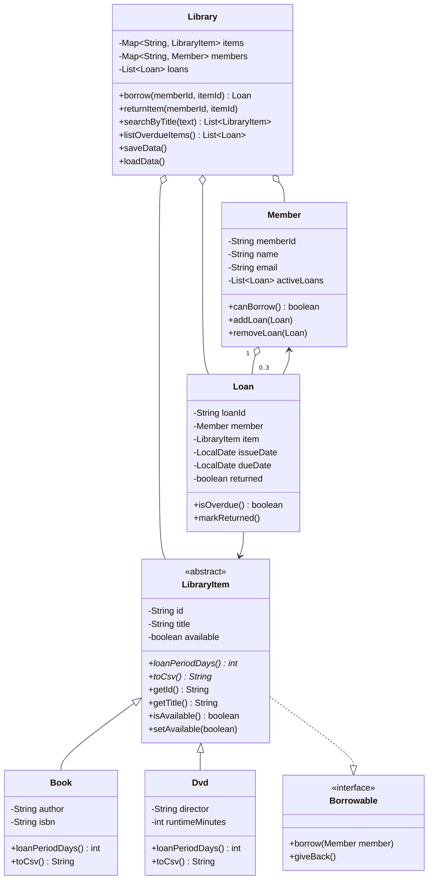

# Mini-Project: University Library Management System

**Student Details:**
- **Name:** Anesu B Kahanda
- **Registration Number:** H250407A
- **Department:** Computer Science
- **Course:** Object-Oriented Programming in Java (Lab 11 Capstone)

---

## Project Overview
This mini-project synthesizes all fundamental object-oriented programming concepts studied throughout the 11 laboratory modules into a complete, working console-based Library Management System.

### Key Features
1. **Domain Modeling:** Models library media items (`Book`, `DVD`), library `Member`s, and `Loan` records with private fields, invariant validation, and descriptive `toString()` methods.
2. **Inheritance & Abstraction:** Abstract base class `LibraryItem` captures shared state (`id`, `title`, `available`) while delegating polymorphic loan period calculations (`loanPeriodDays()`) to specialized media subclasses (14 days for books, 3 days for DVDs).
3. **Interface Implementation:** Standardized `Borrowable` contract declaring borrowing lifecycle operations.
4. **Custom Exceptions & Robust Error Handling:**
   - `ItemNotAvailableException` thrown when attempting to borrow an already checked-out resource.
   - `MemberLimitExceededException` strictly enforcing a maximum quota of 3 active loans per patron.
5. **Collection Architecture:** High-speed $O(1)$ lookups via `Map<String, LibraryItem>` and `Map<String, Member>` keyed by unique identifiers.
6. **Declarative Stream Processing:**
   - Search by title using case-insensitive substring filters and alphabetical sorting.
   - Filtering overdue loans using `LocalDate` calculations.
7. **CSV Persistence Across Sessions:** Complete data state (`items.csv`, `members.csv`, `loans.csv`) is preserved across program executions using Java NIO.

---

## Class Diagram



---

## Files in this Directory

| File Name | Description |
|---|---|
| `LibraryItem.java` | Abstract base class establishing item identification, availability state, and loan duration contract. |
| `Book.java` | Subclass representing books with author, ISBN, and a 14-day standard loan policy. |
| `Dvd.java` | Subclass representing multimedia DVDs with director, runtime, and a 3-day loan policy. |
| `Borrowable.java` | Interface defining checkout and return operations. |
| `Member.java` | Models patrons with contact details and an enforced limit of 3 concurrent loans. |
| `Loan.java` | Represents an active loan contract with automatic due date computation and overdue tracking. |
| `ItemNotAvailableException.java` | Checked exception indicating that an item is currently checked out. |
| `MemberLimitExceededException.java` | Checked exception preventing members from exceeding 3 active loans. |
| `Library.java` | Core business service managing items, members, loans, streaming search queries, and CSV persistence. |
| `LibraryApp.java` | Interactive console user interface with sample seed data and menu options. |

---

## How to Compile and Run

To compile all files:
```bash
javac *.java
```

To run the application:
```bash
java LibraryApp
```

---

## Interactive Menu Options

```
----------------- MAIN MENU -----------------
1. Add Library Item (Book or DVD)
2. Register Library Member
3. Borrow Item
4. Return Item
5. List Overdue Items (Streams)
6. Search Items by Title (Streams)
7. Display All Items and Members
8. Save and Exit
---------------------------------------------
```
